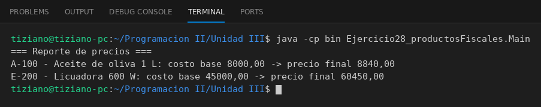

# Producto

Programación II - Unidad 3 - Ejercicio 28

## Consigna
Modelar una jerarquía de clases con herencia: una clase base y subclases que reutilizan código con `super` y sobrescriben métodos. Productos con cálculo fiscal propio.

## Lógica
- `Producto` con código, descripción y costo base.
- `ProductoAlimenticio` aplica un impuesto interno; `Electrodomestico` aplica IVA y un recargo por garantía.
- `calcularPrecioFinal()` se reescribe en cada hija.
- `Main` genera un reporte de precios.

## Ejecución

